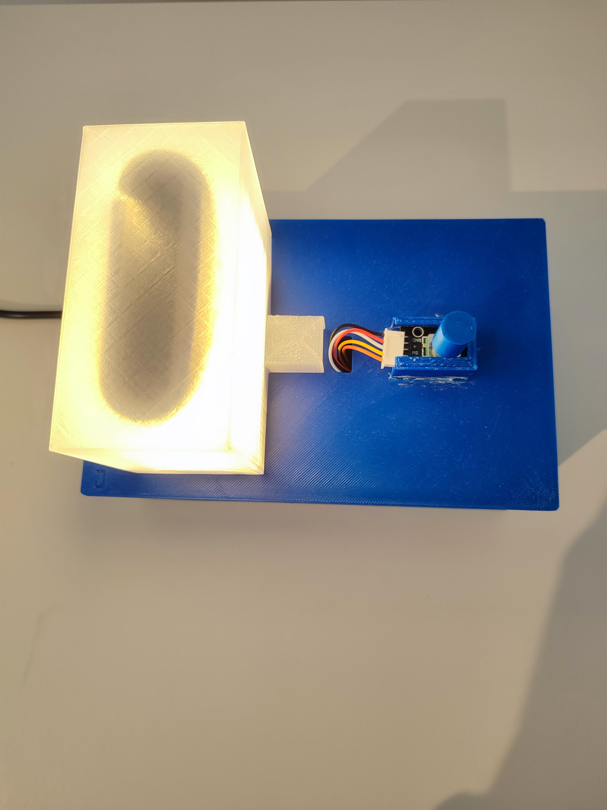
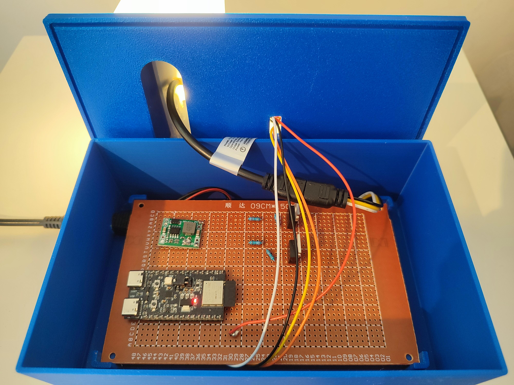

# Smart Wake Up Light

An ESP32-H2 wake-up light with Zephyr RTOS, OpenThread, CoAP, a rotary encoder and a two-channel 24 V LED strip.



## Features

- Nightlight: rotate the encoder to adjust warm-white brightness (0–100%); press to toggle on/off.
- Wake-up: warm white rises from 0 to 100%, followed by cold white rising from 0 to 100% while warm white remains on. A button press stops the animation and switches both channels off.
- Remote wake-up over CoAP (`PUT`/`POST /wakeup`) and SRP/DNS-SD service registration.
- RGB status indicator for the Thread role.
- Configurable Router-promotion and Leader-recovery policy for this installation.

See [architecture](docs/architecture.md) for the software module diagram and [design decisions](docs/decision-records.md) for the non-standard Thread behavior.

## Hardware

| Component | Prototype |
|---|---|
| Controller | ESP32-H2 DevKitM-1 |
| Input | KY-040 rotary encoder |
| LED strip | BTF-LIGHTING 24 V FCOB CCT, 640 LEDs/m, 1 m |
| Switching | 2 × IRLZ44NPBF MOSFETs |
| Supply | CJ-2403 24 V / 3 A DC supply, MP1584EN buck module |



GPIO4 drives **cold white**, GPIO5 drives **warm white**; GPIO8 drives the status LED and GPIO10/11/12 connect to the encoder. Details: [hardware](docs/hardware.md), [PWM and power calculations](docs/pwm-and-power.md).

Power and component ratings depend on the actual strip and wiring. This is an experimental circuit, not a certified product.

## Build and flash

Requirements: a compatible Zephyr SDK, the Zephyr build prerequisites, Python, `west`, and an ESP32-H2 target.

In an empty workspace:

```sh
git clone <REPOSITORY_URL> smart-wakeup-light
cd smart-wakeup-light
python3 -m venv .venv
. .venv/bin/activate
python -m pip install west
west init -l . --mf app/west.yml
west update -n
west zephyr-export
west packages pip --install
west blobs fetch hal_espressif
west build -p -b esp32h2_devkitm app/main_app -d build/esp32h2
west flash -d build/esp32h2
```

For an **already initialized** compatible west workspace, `west init` is not needed; use `west update -n` and build normally. The supplied manifest uses Zephyr's `v4.3-branch`.

Provisioning needs an existing Thread network. **Never commit your operational dataset or Network Key.** See [Thread provisioning](docs/provisioning.md) for private overlays and a synthetic example.

The `app/main_app/local/` hooks in CMake/Kconfig are unused in the public build. They support a separate optional module that may be published independently later. No such module is needed to build this firmware.

## Remote API

The device registers `_smart-wakeup._udp` using SRP, provided the Thread network has an SRP server. A CoAP client can send a Confirmable `PUT` or `POST` to `coap://[DEVICE_IPV6]:5683/wakeup` with ASCII payload `30` to start a 30-second animation. Payload `ping` returns a response without changing the light state.

Successful requests receive `2.04 Changed` when accepted into the command queue. Malformed requests receive `4.00 Bad Request`; queue rejection returns `5.03 Service Unavailable`. The full contract, including other methods and limits, is in [coap-api.yaml](docs/coap-api.yaml).

**Security:** There is currently no CoAPS or application authentication. Any reachable client can control the light. Use only on trusted networks and limit access to UDP 5683. See [limitations and roadmap](docs/known-issues.md).

## Tests and formatting

See [tests/README.md](tests/README.md) for the commands and prerequisites. C unit tests run with Twister/Ztest on `native_sim`. Python tests use pytest. Live CoAP tests discover the device using DNS-SD via the Border Router. Hardware actuation is opt-in.

With `clang-format` installed, from the repository root:

```sh
./scripts/format.sh --check
./scripts/format.sh
```

The first command **checks** formatting without modifying files; the second reformats C and header files in `src/` and `tests/`.

