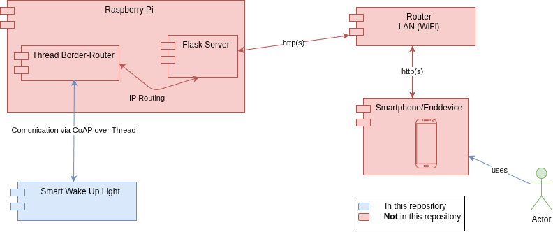
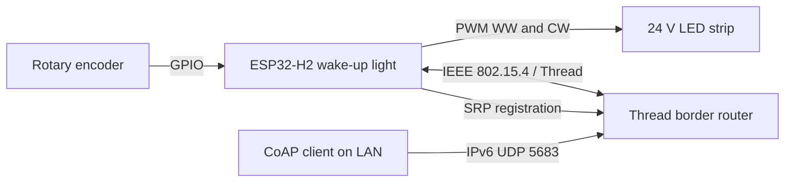
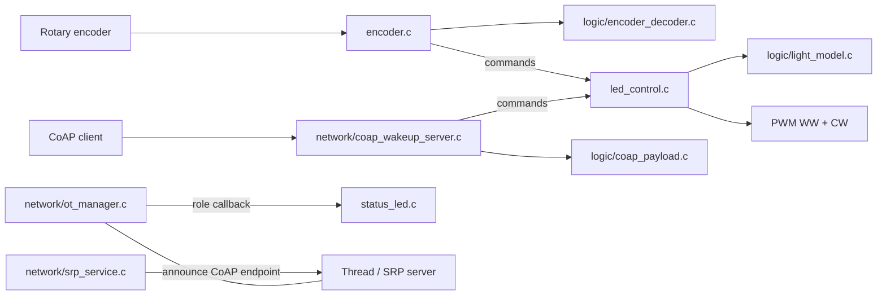

# Architecture

## Integration into an overall system

## System

## Application modules

`main.c` initializes the modules and supplies OpenThread role callbacks. The diagram shows runtime relationships, not a complete call graph.

## Module boundaries

| Location | Responsibility | Dependencies |
|---|---|---|
| `src/logic/` | Pure C state transitions, parsing and decoding | C standard library only |
| `src/network/` | OpenThread lifecycle, SRP and CoAP endpoint | Zephyr and OpenThread |
| `src/` | Startup, encoder GPIO, light PWM and status LED | Zephyr drivers and the two groups above |

The `ot_manager` has a runtime policy and role callback; it has no wake-up-specific Kconfig dependency. `srp_service` accepts its host, instance and service details through a configuration struct. Both pairs of `.c/.h` files can be copied into other Zephyr/OpenThread applications, subject to their stated single-instance lifetimes. The CoAP endpoint is specific to this light; its payload parser is reusable.

## Concurrency

GPIO callbacks defer work to an encoder worker. The light controller serializes commands in its own workqueue and returns an error on queue overflow. OpenThread state-change callbacks schedule deferred role handling. The status LED has its own worker so it does not block Thread callbacks.

The light model returns warm/cold PWM duty cycles in basis points (`0`–`10000`). The nightlight controls warm white only. During wake-up, warm white ramps to 100%, then remains at 100% while cold white ramps to 100%.

See [decision records](decision-records.md) for non-obvious policies and [CoAP contract](coap-api.yaml) for network behavior.
