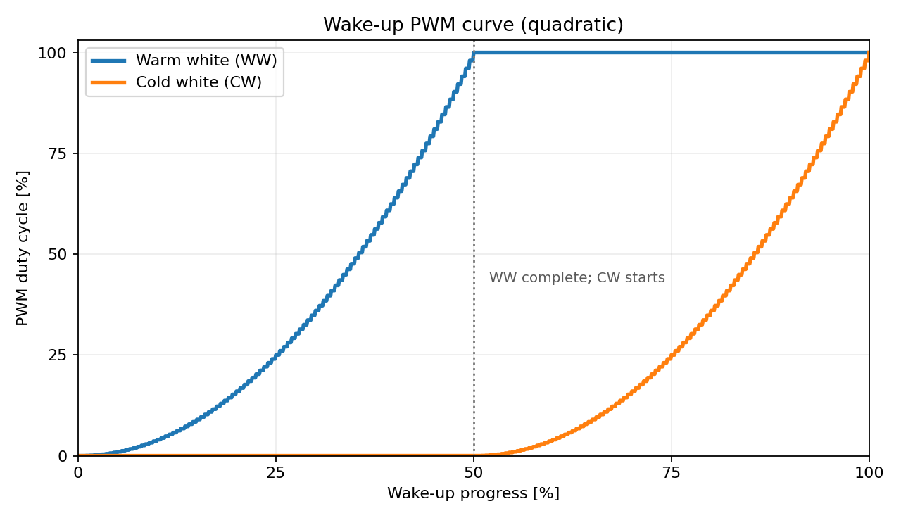

# PWM and power calculations

This note documents the **prototype as published in this repository**. It is meant as a transparent design note for builders, **not** as a safety certification, thermal validation, or measurement report. The intent is to show what is considered in the power budget, what is only estimated, and why the LED strip dominates the calculation.

> **DIY safety note**
> 
> This is a hobby project built from modules and loose wiring. The user of this repository is responsible for correct polarity, insulation, strain relief, protection against shorts, and the suitability of the power supply, wiring, connectors, MOSFETs, and enclosure for their own build. Do not connect mains wiring directly to the LED strip or MCU.

## PWM frequency

Zephyr Devicetree expresses PWM periods in nanoseconds. The ESP32-H2 overlay configures both WW and CW outputs to a period of `1000000` ns:

$$
T=1{,}000{,}000\,\mathrm{ns}=1\,\mathrm{ms}
$$

$$
f=\frac{1}{T}=1{,}000\,\mathrm{Hz}=1\,\mathrm{kHz}
$$

For comparison, a `20000` ns period would produce $50\,\mathrm{kHz}$. A 1 kHz period reduces switching events compared with 50 kHz but **does not guarantee flicker-free light**, particularly during dimming or when filmed. A higher frequency can reduce temporal-light-artifact concerns; for example, $T=400{,}000\,\mathrm{ns}$ corresponds to $2.5\,\mathrm{kHz}$.

The installed firmware currently retains **1 kHz**, because it worked well in the prototype and keeps switching activity moderate. Frequency, duty resolution, MOSFET switching losses, audible effects and visible artefacts must be balanced for the target hardware.

## Wake-up curve

The controller uses a **quadratic mapping from requested brightness to PWM duty cycle**, rather than a linear PWM ramp. The goal is a more even *perceived* brightness increase, because human brightness perception is nonlinear. This is an approximation (gamma exponent 2), not a calibrated photometric curve.

During the first half of the wake-up duration, **warm white (WW)** increases from 0% to 100%. During the second half, WW stays at 100% while **cold white (CW)** increases from 0% to 100%. At completion, both channels have a 100% PWM duty cycle.

The graph plots the **actual calculated PWM duty cycles**, not measured optical output or perceived brightness. With $p$ as the requested channel brightness in percent, the controller calculates:

$$
D(p)=\frac{p^2}{100}\,\% \quad (0\le p\le100)
$$

Thus a request for 50% channel brightness produces **25% PWM duty**, rather than 50%. The firmware advances in integer percent values, so the curve consists of small discrete steps.

The manual **night-light mode** uses the same quadratic mapping for the warm-white channel; the encoder adjusts its requested brightness.

## What is included in the power budget

The power budget below explicitly considers:

- the **24 V LED strip** as the dominant load,
- the **controller side** (ESP32-H2 board + DC/DC converter losses) as a small auxiliary load,
- the **MOSFET gate pull-down resistors** as a negligible load,
- wiring as a source of **voltage drop and resistive loss**.

The intent is to be **more explicit rather than less explicit**. At the same time, the repository does **not** claim measured full-system current or thermal behaviour.

## LED strip and power supply

| Property | Prototype / source |
|---|---|
| LED strip | BTF-LIGHTING FCOB CCT, 640 LEDs/m, 24 V, 1 m (WW + CW) |
| Manufacturer wattage used for calculations | **14 W** for the 1 m strip shipped with the prototype |
| Reported measured current from a third-party review | about **600 mA at 24 V** for 1 m |
| Power supply | CJ-2403, rated 24 V DC, 3 A, 72 W |
| Controller supply | MP1584-based step-down converter feeding the ESP32-H2 board |

Using the manufacturer's 14 W figure for the 1 m LED strip:

$$
I_{\mathrm{LED}}=\frac{P}{U}=\frac{14\,\mathrm{W}}{24\,\mathrm{V}}\approx0.583\,\mathrm{A}
$$

That aligns well with the independently reported value of roughly **0.60 A**.

The power supply is rated for:

$$
P_{\mathrm{PSU}}=72\,\mathrm{W},\qquad I_{\mathrm{PSU,max}}=3\,\mathrm{A}
$$

So, for the documented 1 m strip, the PSU is **nominally much larger than the expected load**.

## Why the LED strip dominates the calculation

The LED strip consumes on the order of **14 W**. The rest of the electronics is much smaller by comparison:

- **ESP32-H2 board + support electronics:** budgeted only as a small auxiliary load on the 24 V side. Even if the 3.3 V domain consumed several hundred milliwatts, the corresponding 24 V input current would still be in the **few-mA to few-tens-of-mA range**, which is small compared with the LED strip's roughly **583 mA**.
- **Rotary encoder (KY-040):** negligible for power-supply sizing.
- **10 kΩ gate pull-downs:** negligible.

For one 10 kΩ pull-down at 3.3 V:

$$
I=\frac{3.3\,\mathrm{V}}{10{,}000\,\Omega}=0.33\,\mathrm{mA}
$$

Two such resistors together dissipate only a few milliwatts.

For repository documentation, it is therefore reasonable to treat the LED strip as the dominant power consumer and the remaining electronics as a small overhead. A practical whole-system estimate is thus still close to:

$$
P_{\mathrm{system}}\approx14\text{ to }15\,\mathrm{W},\qquad I_{\mathrm{system}}\approx0.6\,\mathrm{A}\text{ at }24\,\mathrm{V}
$$

This is an **engineering estimate**, not a measured guarantee.

## MOSFET note

Both channels use IRLZ44NPBF N-MOSFETs driven from 3.3 V GPIOs. The gate-threshold specification is **not** proof of low on-resistance at 3.3 V. The relevant conduction loss per channel is approximately:

$$
P_{\mathrm{MOSFET}}=I_{\mathrm{channel}}^2\,R_{\mathrm{DS(on)}}(V_{GS},T_j)
$$

This repository does not claim a measured MOSFET junction temperature or measured $R_{\mathrm{DS(on)}}$ under the exact prototype conditions. Builders should ensure that the chosen MOSFET and thermal conditions are suitable for their real load.

## Wiring and cable cross-section

Even though the documented 1 m strip only draws about **0.6 A**, wiring still matters for robustness and voltage drop.

For a *two-conductor* copper supply connection of one-way length $L$, conductor area $A$ and current $I$, using approximate copper resistivity $\rho=0.0178\,\Omega\,\mathrm{mm^2/m}$ at 20 °C:

$$
R_{\mathrm{loop}}=\frac{2\rho L}{A},\qquad \Delta V=IR_{\mathrm{loop}},\qquad P_{\mathrm{wire}}=I^2R_{\mathrm{loop}}
$$

For illustration, with $L=1\,\mathrm{m}$, $A=0.5\,\mathrm{mm^2}$ and $I=0.6\,\mathrm{A}$:

$$
R_{\mathrm{loop}}\approx0.0712\,\Omega,
$$

$$
\Delta V\approx0.0427\,\mathrm{V},
$$

$$
P_{\mathrm{wire}}\approx0.0256\,\mathrm{W}
$$

These are **example values only**, not measured prototype losses.

### Practical recommendation for this prototype

For a short 24 V connection feeding the documented **1 m / ~0.6 A** LED strip:

- **at least 0.25 mm²** is a sensible lower bound,
- **0.5 mm²** is a robust and convenient choice for hand wiring,
- use larger conductors for longer runs, worse cooling, or higher loads.

For a three-wire shared-positive CCT strip, remember that the shared positive conductor and the two return conductors must all be suitable for the actual current paths in the selected operating mode.

## Summary

For the published prototype, the main takeaway is simple:

- the **LED strip is by far the dominant load**, 
- the **controller side is small in comparison**,
- the **24 V / 3 A PSU is nominally sufficient** for the documented 1 m / 14 W strip,
- and **safe wiring remains the builder's responsibility**.

## References
- [Zephyr PWM Interface](https://docs.zephyrproject.org/latest/hardware/peripherals/pwm.html)
- [Espressif ESP32-H2 LEDC Peripheral Documentation](https://docs.espressif.com/projects/esp-idf/en/stable/esp32h2/api-reference/peripherals/ledc.html)
- [Infineon IRLZ44NPbF Datasheet](https://www.infineon.com/assets/row/public/documents/24/49/infineon-irlz44npbf-datasheet-en.pdf)
- [Monolithic Power Systems MP1584 Datasheet](https://www.wiltronics.com.au/wp-content/uploads/datasheets/mp1584-datasheet.pdf)
- Product listing/specification supplied with the prototype build